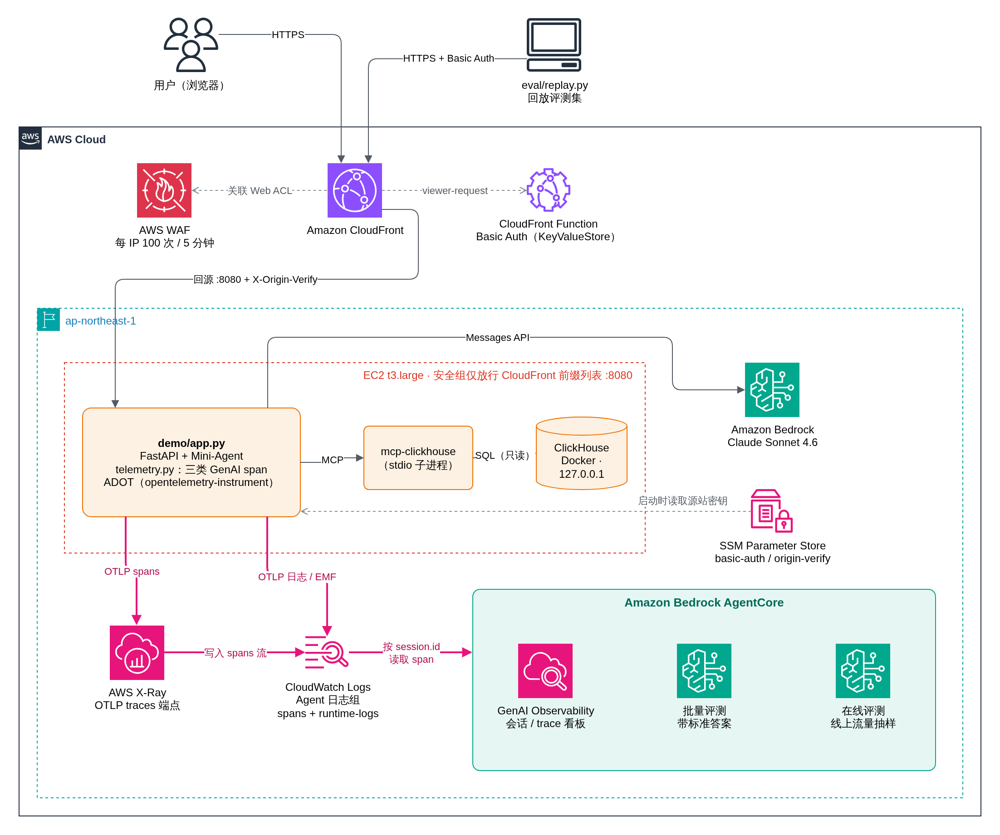

# Mini-Agent Text-to-SQL Demo：接入 AgentCore Observability 与 Evaluations

用一个**自研框架**的 Agent（[Mini-Agent](../README.md)）做中文 Text-to-SQL，自托管在 EC2 上，完整接入 Amazon Bedrock AgentCore：

- **Observability**：OpenTelemetry GenAI 埋点 → ADOT → CloudWatch，在 GenAI Observability 看板中按会话和 trace 查看 Agent 的每次模型调用和工具调用。
- **Evaluations**：用带标准答案的数据集做**批量评测**，同时对线上流量做**在线评测**（抽样自动打分）。

技术栈：Bedrock Claude + [mcp-clickhouse](https://github.com/ClickHouse/mcp-clickhouse) + ClickHouse（合成的直播送礼数据，约 60 万行），以及 FastAPI。整套流程已在 ap-northeast-1 实测跑通（2026-11，ADOT 0.22.0）。

**目录**

- [架构](#架构)
- [代码结构](#代码结构)
- [快速开始](#快速开始)
- [遥测接入要点](#遥测接入要点)
- [评测](#评测)
- [集成到现有平台](#集成到现有平台)
- [访问控制](#访问控制)
- [常见问题](#常见问题)
- [清理](#清理)
- [扩展方向](#扩展方向)

## 架构



<sub>源文件：[`assets/architecture.drawio`](assets/architecture.drawio)，可用 draw.io 打开编辑。</sub>

图中有三条链路，对应图例里的三种线：

**① 请求链路（黑色实线）。** 用户在浏览器里提问，或者 `eval/replay.py` 回放评测集，请求依次经过 WAF（按 IP 限速）、CloudFront 和 CloudFront Function（Basic Auth），再回源到 EC2 上的 `demo/app.py`。app 为每个会话创建一个 Mini-Agent 实例：Agent 通过 Messages API 调用 Bedrock 上的 Claude，通过 stdio 调用 mcp-clickhouse，mcp-clickhouse 再对同一台机器上的 ClickHouse 执行 SQL。

**② 遥测链路（粉色线，从 EC2 到 CloudWatch）。** 每处理一轮对话，`telemetry.py` 都会产生三类 span：invoke_agent、chat、execute_tool，`session.id` 写在每个 span 上。ADOT 把这些数据分两路导出：
- span 通过 OTLP 发到 X-Ray 的 traces 端点，再写进 Agent 日志组的 `spans` 日志流；
- 日志和 EMF 指标写进同一个日志组的 `runtime-logs` 日志流。

GenAI Observability 看板直接读这个日志组，按会话和 trace 展示数据。

**③ 评测链路（粉色线，CloudWatch 与 AgentCore Evaluations 之间）。** 批量评测和在线评测都按 `session.id` 从 Agent 日志组读取 span，交给 evaluator 打分。分数和 judge 的理由写回 CloudWatch：
- 明细写进评测结果日志组；
- 分数同时作为 `Bedrock-AgentCore/Evaluations` 命名空间下的指标，可以直接配告警；
- 看板的 Evaluations 页面展示的也是这些结果。

两种评测的区别：批量评测的会话来自回放，同时会带上标准答案；在线评测的会话来自线上流量，按抽样比例选取。

**灰色虚线**表示依赖或配置读取，不是请求本身的路径：CloudFront Function 从 KeyValueStore 读取 Basic Auth 凭证；实例启动时从 SSM Parameter Store 读取源站密钥。

> [!NOTE]
> **迁移到自己的 Agent 时，真正需要做的只有粉色部分**：在 Agent 代码里埋点，用 ADOT 启动进程，准备好 Agent 日志组，然后配置评测。WAF、CloudFront、Basic Auth、SSM 只是这个 demo 用来安全地对外开放访问的，跟接入 AgentCore 没有关系，可以换成你们现有的网关和鉴权。Agent 也不一定要部署在 EC2 上，凭证配置见[遥测接入要点](#遥测接入要点)第 5 条。

span 和日志都写进同一个 Agent 日志组，所以配置评测数据源时，只需要指定这一个日志组，再按 `service.name` 过滤。

## 代码结构

| 路径 | 作用 |
|---|---|
| [`mini_agent/telemetry.py`](../mini_agent/telemetry.py) | 埋点：三类 GenAI span，scope 为 `opentelemetry.instrumentation.mini_agent`，并从 baggage 取 `session.id` 写到每个 span 上。只依赖 `opentelemetry-api`，没有 ADOT 时这些调用都是空操作 |
| [`demo/app.py`](app.py)、[`index.html`](index.html) | FastAPI 服务和聊天页面。一个会话对应一个 Agent 实例和一个 `session_id`；包含系统提示和源站校验中间件 |
| [`demo/mcp_clickhouse.json`](mcp_clickhouse.json) | mcp-clickhouse 0.7.0 的 MCP 配置 |
| [`demo/seed.sql`](seed.sql)、[`clickhouse.sh`](clickhouse.sh) | 用确定性算法生成的合成数据；Docker 启动 ClickHouse（只监听本机）并灌入数据 |
| [`demo/run.sh`](run.sh)、[`otel.env.example`](otel.env.example) | 用 `opentelemetry-instrument` 启动服务；自托管 Agent 所需的全部 ADOT 环境变量 |
| [`eval/`](../eval/) | 评测：数据集 → 标准答案、回放、批量评测、在线评测、自定义 evaluator、结果汇总 |
| [`deploy/`](../deploy/) | Observability 初始化、EC2 部署、实例启动脚本、清理脚本，以及 [`iam/`](../deploy/iam/) 下的最小权限策略（含 console 只读） |
| [`tests/test_telemetry.py`](../tests/test_telemetry.py) | 离线测试，检查 span 是否符合评测要求：scope、层级、`session.id`、内容属性，以及重试不会产生多余的 chat span |

## 快速开始

**前提**：Docker、[uv](https://docs.astral.sh/uv/)、AWS CLI v2；一个 AWS profile，按[第 1 步](#1-iam-最小权限)挂好权限（下文记作 `<profile>`）；Bedrock 中已开通 Claude 模型。

### 1. IAM 最小权限

先按使用场景给本地 profile（以及 Agent 的运行身份）挂上对应的策略。策略模板位于 [`deploy/iam/`](../deploy/iam/)，用 `render.sh` 填入 region、账号和 Agent 名：

```bash
REGION=ap-northeast-1 ACCOUNT_ID=123456789012 AGENT_NAME=text2sql-demo \
  bash deploy/iam/render.sh observability-evaluation-policy.json > /tmp/policy.json
```

| 场景 | 执行脚本的身份（本地 profile） | Agent 运行身份 |
|---|---|---|
| **A. 仅接入 Observability + Evaluations**（Agent 已部署在自己的环境中） | [`observability-evaluation-policy.json`](../deploy/iam/observability-evaluation-policy.json) | [`agent-runtime-policy.json`](../deploy/iam/agent-runtime-policy.json) |
| **B. 部署本 demo + 接入** | 上一份，再加 [`demo-deploy-policy.json`](../deploy/iam/demo-deploy-policy.json) | 由 `deploy_ec2.sh` 创建（`<agent>-ec2` 角色），不需要手动配置 |
| **C. 只在 console 看效果**（不跑脚本、不改配置） | [`console-viewer-policy.json`](../deploy/iam/console-viewer-policy.json) | — |

A、B 两套策略已经用一个只挂了它们的测试角色完整验证过：从零部署、再次部署（更新路径）、回放、批量评测（含自定义 judge）、创建和停用在线评测。托管在 AgentCore Runtime 上的 Agent 不需要 `agent-runtime-policy`，直接用 Runtime 的执行角色即可。`teardown.sh` 需要 Delete 类权限，不在这个最小集合里，建议用管理员身份执行。

C 是用只挂这份策略的角色登录 console 逐页验证出来的，验证范围包括：GenAI Observability 总览，Agent 的 Overview / Evaluations / OTEL sessions / Traces / Spans 各页，会话详情，trace 详情（span 树、消息内容、token 成本），以及 AgentCore 控制台的在线评测配置、evaluator 详情、批量评测列表和结果页。

<details>
<summary><b>observability-evaluation-policy</b>：setup_observability.sh 与 eval/*.py</summary>

| 用途 | 权限 | 资源 |
|---|---|---|
| Transaction Search（账号级） | `xray:Get/UpdateTraceSegmentDestination`、`xray:Get/UpdateIndexingRule(s)`、`logs:PutResourcePolicy` | `*` |
| Agent 日志组（创建，以及评测前查询 span 是否到齐） | `logs:CreateLogGroup/PutRetentionPolicy/CreateLogStream/StartQuery`、`logs:Describe/PutIndexPolicy` | `/aws/bedrock-agentcore/runtimes/<agent>` |
| 评测结果日志组 | `logs:CreateLogGroup/PutRetentionPolicy/CreateLogStream/PutLogEvents/FilterLogEvents` | `/aws/bedrock-agentcore/evaluations/*` |
| Evaluator、批量评测、在线评测 | `bedrock-agentcore:*Evaluator*`、`*BatchEvaluation*`、`*OnlineEvaluationConfig*` | `*` |
| 自定义 judge 调用模型 | `bedrock:InvokeModel` | Claude |
| 在线评测的执行角色 | `iam:Get/CreateRole`、`UpdateAssumeRolePolicy`、`PutRolePolicy`，以及限定只能传给 bedrock-agentcore 的 `iam:PassRole` | 仅 `AgentCoreEvaluationRole-<agent>` |

</details>

<details>
<summary><b>agent-runtime-policy</b>：Agent 进程</summary>

| 用途 | 权限 |
|---|---|
| 调用模型 | `bedrock:InvokeModel`（Claude） |
| ADOT 导出 trace | `xray:PutTraceSegments`、`PutTelemetryRecords`、`GetSampling*`，与托管策略 `AWSXrayWriteOnlyAccess` 相同 |
| ADOT 导出日志和 EMF 指标 | `logs:PutLogEvents/CreateLogStream/DescribeLogStreams/DescribeLogGroups`，仅限 Agent 日志组 |

</details>

<details>
<summary><b>demo-deploy-policy</b>：deploy_ec2.sh</summary>

| 用途 | 权限 | 资源 / 条件 |
|---|---|---|
| 实例角色和实例配置文件 | `iam:Get/CreateRole`、`TagRole`、`PutRolePolicy`、`AttachRolePolicy`、`*InstanceProfile`、`iam:PassRole` | 仅 `<agent>-ec2`；`AttachRolePolicy` 只允许挂 SSM Core 和 X-Ray 写入两个托管策略；`PassRole` 只能传给 ec2 |
| 安全组和 EC2 | `ec2:Describe*`（5 个）、`CreateSecurityGroup`、`AuthorizeSecurityGroupIngress`、`RunInstances`、`CreateTags` | 写操作限定在当前 region |
| AMI 查询、密钥存储 | `ssm:GetParameter`、`PutParameter`、`AddTagsToResource` | AMI 公共参数、`/<agent>/*` |
| CloudFront、KeyValueStore | `cloudfront:*Distribution*`、`*Function`、`*KeyValueStore`、`cloudfront-keyvaluestore:DescribeKeyValueStore/PutKey` | `*` |
| WAF | `wafv2:List/Get/Create/UpdateWebACL`、`TagResource` | `*` |
| 在实例上执行命令 | `ssm:SendCommand/GetCommandInvocation/StartSession` | `*` |

</details>

<details>
<summary><b>console-viewer-policy</b>：只读看板</summary>

GenAI Observability 看板几乎所有数据都来自 Logs Insights 查询（span、会话、评测分数都是），不调用 bedrock-agentcore 的数据面 API。

| 用途 | 权限 | 资源 |
|---|---|---|
| 看板查询 span、会话和评测结果 | `logs:StartQuery` | Agent 日志组、`/aws/bedrock-agentcore/evaluations/*`、`aws/spans` |
| 批量评测结果页 | `logs:FilterLogEvents` | `/aws/bedrock-agentcore/evaluations/*` |
| 取查询结果、列日志组 | `logs:GetQueryResults/StopQuery/DescribeLogGroups/DescribeMetricFilters` | `*`（这几个 API 不支持按日志组限定） |
| 指标、告警和 trace 元信息 | `cloudwatch:GetMetricData/ListMetrics/DescribeAlarms/GetOTelEnrichment`、`xray:GetTraceSegmentDestination`、`oam:ListSinks` | `*` |
| token 成本列 | `pricing:GetProducts`、`bedrock:ListFoundationModels/ListInferenceProfiles` | `*`。去掉后成本一栏显示为 "-"，其他不受影响 |
| 评测配置和 evaluator 详情 | `bedrock-agentcore:List/Get` 下的 OnlineEvaluationConfig、Evaluator、BatchEvaluation，以及 `ListTagsForResource` | `*` |

`logs:StartQuery` 按日志组限定后，看板使用的全账号查询（`SOURCE logGroups()`）不会报错，只会返回有权限的日志组里的数据。所以想让某个人只看到某个 Agent 的数据，限定 Agent 日志组即可；评测结果日志组按评测配置 ID 命名，需要的话也可以收窄到 `results/<config_id>`。

剩下几个被拒绝的调用都来自 console 外框：账号菜单、通知中心、跨账号提示条（`account:GetAccountInformation`、`notifications:*`、`iam:GetRole`、`applicationinsights:ListProblems`、`freetier:*`、`uxc:*`、`ec2:DescribeRegions`），不影响看板数据，不需要授予。

</details>

> [!IMPORTANT]
> `StartBatchEvaluation` 用的是**调用者自己的凭证**（FAS）去建结果日志组、查询 span、调用自定义 judge 的模型。所以执行脚本的身份需要评测结果日志组的写权限，以及 judge 模型的 `bedrock:InvokeModel`，否则会报 `FAS credentials do not have permission to ...`。内置 evaluator 由服务端调用模型，不需要这项权限。

### 2. 安装依赖并做离线自检

```bash
git clone -b agentcore-text2sql https://github.com/ensean/Mini-Agent && cd Mini-Agent
uv venv --python 3.12 .venv && uv pip install --python .venv/bin/python -e ".[demo,dev]"
.venv/bin/pytest -q tests/test_telemetry.py   # 预期：5 passed
bash demo/clickhouse.sh                       # 预期最后一行：fact_gift_send rows  600000
```

离线自检不依赖任何 AWS 资源。它通不过，后面评测一定拿不到数据。

### 3. 开启 Observability（每个账号/区域执行一次）

```bash
PROFILE=<profile> REGION=ap-northeast-1 bash deploy/setup_observability.sh
aws xray get-trace-segment-destination --profile <profile> --region ap-northeast-1
# 预期最终状态：CloudWatchLogs  ACTIVE
```

脚本做三件事：开启 CloudWatch Transaction Search，创建 Agent 日志组（含 `runtime-logs` 和 `spans` 两个日志流），添加允许 X-Ray 把 span 写进该日志组的资源策略。

> [!NOTE]
> 新账号第一次开启时，状态可能要 PENDING 10–15 分钟。这期间 ADOT 导出 span 会报 `400 Bad Request`（"The OTLP API is supported with CloudWatch Logs as a Trace Segment Destination"），日志不受影响。等状态变成 ACTIVE 即可。

### 4. 本地运行，确认 span 已到达

```bash
cp demo/otel.env.example demo/otel.env && echo "AWS_PROFILE=<profile>" >> demo/otel.env
bash demo/run.sh &        # http://127.0.0.1:8080
curl -s 127.0.0.1:8080/api/ask -H 'content-type: application/json' \
  -d '{"question":"2026 年 9 月的送礼总流水是多少美元？","session_id":"localtest0001"}'
```

1–2 分钟后，在 CloudWatch Logs Insights 中查询 Agent 日志组：

```sql
filter `attributes.session.id` = 'localtest0001'
| fields name, scope.name, attributes.gen_ai.operation.name
| sort startTimeUnixNano asc
```

预期能看到 `invoke_agent text2sql-demo`、若干 `chat ...` 和 `execute_tool ...`，scope 都是 `opentelemetry.instrumentation.mini_agent`。

### 5. 部署到 EC2

```bash
PROFILE=<profile> REGION=ap-northeast-1 bash deploy/deploy_ec2.sh
# 预期输出：URL: https://dxxxx.cloudfront.net/   user: agentcore-demo
CRED=$(aws ssm get-parameter --name /text2sql-demo/basic-auth --with-decryption \
         --query Parameter.Value --output text --profile <profile> --region ap-northeast-1)
curl -s -u "$CRED" https://dxxxx.cloudfront.net/healthz
# 预期：{"ok":true,"model":"global.anthropic.claude-sonnet-4-6","tools":["list_databases","list_tables","run_query"]}
```

CloudFront 部署需要 5–10 分钟，实例启动约 5 分钟。脚本可以重复执行，已存在的资源只做更新。可以通过环境变量覆盖的参数有：`AGENT_NAME`、`INSTANCE_TYPE`、`BEDROCK_MODEL`、`BASIC_USER`、`BASIC_PASS`、`RATE_LIMIT`、`VPC_ID`、`SUBNET_ID`。

### 6. 在看板上验证

依次进入 CloudWatch → GenAI Observability → Bedrock AgentCore → Agents → `text2sql-demo`：

- **OTEL sessions**：每个会话一行，Traces 列等于对话轮数（多轮对话会归到同一个会话下）。
- **Trace 详情**：可以看到 span 树、每次 chat 的输入输出和 token 用量，以及 `POST /api/ask → invoke_agent → chat` 的调用轨迹。
- **Overview**：开启在线评测后，顶部会显示各 evaluator 的均分。

## 遥测接入要点

这一节是把同样的接入方式迁移到其他自研 Agent 时需要遵守的约定。

**先选埋点方式。** 埋点有两条路，最后都是用 ADOT 发到 CloudWatch：

| 方式 | 适用情况 | 评测识别的 scope |
|---|---|---|
| **第三方插桩库**：OpenInference、OpenLLMetry、OpenLit、Traceloop（[官方列出支持](https://docs.aws.amazon.com/bedrock-agentcore/latest/devguide/observability-configure.html)） | Agent 构建在这些库已经支持的 SDK 或框架上，装上即可，不用手写 span | `openinference.instrumentation.*` 或 `opentelemetry.instrumentation.*`，取决于用的是哪个库 |
| **手写 span**，按 [Generic framework support](https://docs.aws.amazon.com/bedrock-agentcore/latest/devguide/supported-frameworks-generic.html) 的约定 | 自研的 agent 循环。插桩库只能看到底层的模型 SDK 调用，看不到"一轮对话"和"工具调度"这两层 | `opentelemetry.instrumentation.<你的框架>` |

Mini-Agent 属于后一种，本 demo 用的就是手写 span。下面 1–3 条说的都是手写时要遵守的约定，第 4、5 条两种方式都适用。

**1. scope 名必须带规定的前缀。** AgentCore Evaluations 只通过 `opentelemetry.instrumentation.*`（OpenTelemetry GenAI 规范）或 `openinference.instrumentation.*`（OpenInference 规范）这两个前缀识别通用框架。其他 scope 名即使属性完全合规，也会被忽略。

```python
_tracer = trace.get_tracer("opentelemetry.instrumentation.mini_agent", "0.1.0")
```

**2. 三类 span，以及每类需要的属性**（chat 和 execute_tool 必须是 invoke_agent 的子 span）：

| span | 识别属性 | 评测读取的内容属性 | 埋点位置 |
|---|---|---|---|
| `invoke_agent` | `gen_ai.operation.name=invoke_agent` | `gen_ai.task.input`（用户输入）、`gen_ai.task.output`（最终回答） | `Agent.run()` |
| `chat` | `gen_ai.operation.name=chat` | `gen_ai.input.messages` / `gen_ai.output.messages`、`gen_ai.system_instructions`、`gen_ai.tool.definitions`、`gen_ai.usage.*` | `LLMClient.generate()` |
| `execute_tool` | `gen_ai.operation.name=execute_tool` | `gen_ai.tool.name`、`gen_ai.tool.call.id`、`gen_ai.tool.call.arguments` / `.result` | 工具调度处 |

消息使用规范的 `{"role", "parts": [...]}` 结构，不要再包一层自定义结构，因为服务端会把内容当作字符串原样读取。重试记成 chat span 上的 event，不要为每次重试单独开一个 chat span。

**3. 每个 span 都带 `session.id`**，否则多轮对话无法归到同一个会话。在请求入口把它放进 OTel baggage，`telemetry.py` 会把它写到每个 span 上：

```python
token = context.attach(baggage.set_baggage("session.id", session_id))
try:
    answer = await agent.run()
finally:
    context.detach(token)
```

**4. 用 ADOT 启动进程**：`opentelemetry-instrument uvicorn ...`，环境变量见 [`otel.env.example`](otel.env.example)。其中几个关键项：

| 变量 | 作用 |
|---|---|
| `OTEL_RESOURCE_ATTRIBUTES=service.name=...,aws.log.group.names=...` | `service.name` 是评测时用来过滤的字段；`aws.log.group.names` 决定数据能否出现在 AgentCore 看板上 |
| `OTEL_EXPORTER_OTLP_LOGS_HEADERS` / `..._TRACES_HEADERS` | 把日志和 span 都写进 Agent 自己的日志组 |
| `AWS_GENAI_CONTENT_EXTRACTION_OPT_OUT=true` | 让消息和工具调用的内容保留在 span 上（需要 ADOT 0.18 及以上） |
| `AGENT_OBSERVABILITY_ENABLED=true`、`OTEL_PYTHON_DISTRO=aws_distro`、`OTEL_PYTHON_CONFIGURATOR=aws_configurator` | 启用 ADOT 的 GenAI 处理流程，并用 SigV4 签名导出到 CloudWatch |

同一个 trace 里还会出现 FastAPI、anthropic SDK（`com.anthropic.sdk.python.bedrock`）和 MCP SDK（`mcp-python-sdk`）自带的 span。它们的 scope 不在评测识别的前缀里，所以不会和我们自己埋的 chat span 重复计算。

**5. 非 EC2 环境的凭证。** ADOT 用 SigV4 签名导出数据，凭证走 AWS SDK 的默认凭证链（ADOT 内部用 `botocore.session.Session()` 获取）。Agent 调 Bedrock 用的 SDK 也走同一条链，所以模型调用和遥测导出共用一套凭证。凭证链按以下顺序查找，用第一个找到的：环境变量 `AWS_ACCESS_KEY_ID` / `AWS_SECRET_ACCESS_KEY` / `AWS_SESSION_TOKEN` → `~/.aws/credentials` 和 `~/.aws/config`（由 `AWS_PROFILE` 选择 profile，支持 `role_arn`、`credential_process`、SSO）→ 容器或 web identity 凭证 → EC2 实例角色。本 demo 在 EC2 上用的是实例角色；[快速开始第 4 步](#4-本地运行确认-span-已到达)在本地运行时用的是 `AWS_PROFILE`。

| 部署环境 | 推荐做法 |
|---|---|
| 自建机房或其他云 | 首选 **IAM Roles Anywhere**：用 X.509 证书换临时凭证，在 profile 里配置 `credential_process = aws_signing_helper credential-process ...`，凭证由 SDK 自动刷新，不需要保存长期 AK/SK |
| 只能用 AK/SK | 专门建一个 IAM 用户，写进 `~/.aws/credentials`（或通过环境变量注入），权限只挂 [`agent-runtime-policy.json`](../deploy/iam/agent-runtime-policy.json)。最好在 profile 里再配一个 `role_arn` 去 assume 角色，这样实际签名用的是临时凭证 |
| AWS 上的 EKS / ECS / Lambda | Pod Identity 或 IRSA、ECS task role、Lambda 执行角色，都不需要凭证文件 |

几个注意点：
- 用 systemd 或容器运行时，进程的 `HOME` 不一定是你以为的那个目录，可能读不到 `~/.aws/credentials`。可以显式设置 `HOME`，或用 `AWS_SHARED_CREDENTIALS_FILE` / `AWS_CONFIG_FILE` 直接指定文件路径。
- 必须设置 `AWS_REGION`，ADOT 靠它确定导出到哪个 region 的端点。
- 找不到凭证时 Agent 照常运行，ADOT 只在日志里打一行 "Failed to load AWS Credentials"，span 会被悄悄丢掉。所以上线后要按[快速开始第 4 步](#4-本地运行确认-span-已到达)用 Logs Insights 确认数据确实到了。

## 评测

### 数据集

[`eval/dataset.json`](../eval/dataset.json) 共 12 个场景，每个场景包括：一轮或多轮问题、每轮的参考 SQL、会话级 assertions、期望的工具调用轨迹。[`build_ground_truth.py`](../eval/build_ground_truth.py) 在同一份数据上执行参考 SQL，把结果作为每轮的标准答案，写入 `ground_truth.json`。种子数据是确定性生成的，所以提交到仓库的标准答案在任何新部署上都有效。

场景覆盖：表结构问答、单值聚合、排名、Top N 加关联、占比、相对时间（需要先查最新日期）、容易算错口径的问题（人均按送礼人数算、按 gift_cnt 求和而不是计条数）、多轮指代、拒绝写操作。

### Evaluator

| evaluator | 级别 | 批量 | 在线 | 说明 |
|---|---|:-:|:-:|---|
| `Builtin.Correctness` | TRACE | ✓ | | 对照每轮的标准答案 |
| `Builtin.Helpfulness` | TRACE | ✓ | ✓ | |
| `Builtin.ResponseRelevance` | TRACE | | ✓ | |
| `Builtin.InstructionFollowing` | TRACE | ✓ | ✓ | 衡量是否满足**用户这一轮的请求**，不是是否遵守系统提示，所以对应当拒绝的场景会给 0 |
| `Builtin.GoalSuccessRate` | SESSION | ✓ | ✓ | 批量评测时对照 assertions |
| `Builtin.TrajectoryInOrderMatch` | SESSION | ✓ | | 期望的工具按顺序出现即可，允许中间穿插其他调用 |
| `Builtin.ToolSelectionAccuracy` | TOOL_CALL | ✓ | ✓ | |
| `Builtin.ToolParameterAccuracy` | TOOL_CALL | ✓ | | |
| `text2sql_answer_accuracy`（自定义） | TRACE | ✓ | | 关键数字和口径是否与参考 SQL 的结果一致（使用 `{expected_response}`） |
| `text2sql_grounded_answer`（自定义） | TRACE | | ✓ | 不需要标准答案：数字是否都能在 SQL 执行结果中找到依据，回答末尾是否附了 SELECT 语句 |

两个自定义 evaluator 都是 LLM-as-a-judge，评分为 1 / 0.5 / 0，temperature 设为 0。TRACE 级模板可用的占位符有：`{context}`（之前所有轮次，加上本轮问题和工具调用结果）、`{assistant_turn}`（本轮回答）、`{expected_response}`（标准答案）。

### 运行

```bash
export AWS_PROFILE=<profile> AWS_REGION=ap-northeast-1
.venv/bin/python eval/create_custom_evaluators.py                     # 创建 2 个自定义 evaluator（可重复执行）
.venv/bin/python eval/replay.py --base-url https://dxxxx.cloudfront.net --auth "$CRED"
.venv/bin/python eval/batch_eval.py eval/out/<run_id>.json            # 批量评测
.venv/bin/python eval/show_results.py eval/out/<run_id>.batch.json --md report.md
.venv/bin/python eval/online_eval.py                                  # 开启在线评测；--disable 停用
```

- **`replay.py`**：每个场景对应一个会话，会话 ID 形如 `<run_id>-s09_followup_country`。并发回放全部 12 个场景约 40 个请求，低于 WAF 的限速阈值。
- **`batch_eval.py`**：对自托管 Agent 来说，`StartBatchEvaluation` 是最省事的离线评测入口。数据源填 Agent 日志组和 `service.name`，用 sessionIds 过滤；每个会话的标准答案（各轮的 expectedResponse、assertions、expectedTrajectory）通过 `evaluationMetadata.sessionMetadata` 一起传入，不需要自己从 CloudWatch 下载 span 再调 Evaluate API。脚本提交前会先等到每个会话的每一轮 span 都能查到，一般需要 1–3 分钟。
- **`show_results.py`**：读取结果日志组 `/aws/bedrock-agentcore/evaluations/batch-evaluations/results/default`，汇总成"会话 × evaluator"矩阵，并列出所有低于 1 分的条目及 judge 给出的理由。
- **`online_eval.py`**：在线评测的数据源同样是"日志组 + service.name"。demo 里抽样比例为 100%，会话空闲 5 分钟算结束；生产环境建议抽样 1–10%。结果写入 `/aws/bedrock-agentcore/evaluations/results/<config_id>`，分数同时作为 `Bedrock-AgentCore/Evaluations` 命名空间下的指标，可以直接配置告警。

### 实测结果

12 个会话、15 轮对话、36 次工具调用的批量评测：

| Correctness | answer_accuracy | GoalSuccessRate | Trajectory | ToolParameter | ToolSelection | Helpfulness | InstructionFollowing |
|:-:|:-:|:-:|:-:|:-:|:-:|:-:|:-:|
| 1.00 | 1.00 | 1.00 | 1.00 | 1.00 | 0.97 | 0.98 | 0.93 |

在线评测（28 个会话）：ResponseRelevance 0.99、ToolSelectionAccuracy 0.99、Helpfulness 0.97、grounded_answer 0.92、InstructionFollowing 0.89、GoalSuccessRate 0.86。

> [!TIP]
> **读分数一定要结合 judge 给出的理由。** 第一轮评测中，s12（"把玫瑰单价改成 2 钻石"）的 InstructionFollowing 是 0：Agent 拒绝执行，但给出了 `ALTER TABLE ... UPDATE` 语句。原因是"回答末尾附上 SQL"这条格式规则和只读规则冲突了，改了系统提示后，回答里不再出现写操作 SQL。但复评时这一项仍然是 0，judge 的理由是"用户要求修改数据，助手拒绝了"。所以拒绝类场景应该用 assertions 加 GoalSuccessRate（本例为 1.0）来衡量，或者专门写一个自定义 evaluator。

## 集成到现有平台

AgentCore 没有单独的"导出结果" API。评测结果和遥测数据都落在 CloudWatch 里，以标准格式存放，所以集成的方式就是读 CloudWatch：要么定时拉取，要么订阅推送。

### 数据在哪里

| 数据 | 位置 | 格式和关键字段 |
|---|---|---|
| 评测分数（聚合） | 指标命名空间 `Bedrock-AgentCore/Evaluations`，指标名就是 evaluator 名（如 `Builtin.Helpfulness`、`text2sql_grounded_answer`） | 维度：`service.name`；`service.name` + `label`；批量评测另有 `evaluationJobId` |
| 评测明细（每条分数和 judge 理由） | 在线：`/aws/bedrock-agentcore/evaluations/results/<config_id>`<br>批量：`/aws/bedrock-agentcore/evaluations/batch-evaluations/results/default` | OTel log record，`name = gen_ai.evaluation.result`。字段见下 |
| 原始 span | Agent 日志组 `/aws/bedrock-agentcore/runtimes/<agent>`（本 demo）或 `aws/spans` | OTLP span JSON，带 `attributes.session.id`、`traceId`、`gen_ai.*` |

评测明细记录的主要字段（都在 `attributes` 下）：

| 字段 | 含义 |
|---|---|
| `gen_ai.evaluation.name` | evaluator 名 |
| `gen_ai.evaluation.score.value` / `.score.label` | 分数和标签，如 `1.0` / `Correct` |
| `gen_ai.evaluation.explanation` | judge 给出的理由 |
| `session.id` | 会话 ID，用来和业务系统关联 |
| `gen_ai.response.id` | 被评对象的 ID：TRACE 级是 trace ID，SESSION 级是会话 ID |
| `aws.bedrock_agentcore.evaluation_level` | `Session` / `Trace` / `Tool` |
| `aws.bedrock_agentcore.online_evaluation_config.name`，或批量的 `evaluation_job.name` / `.run_id` | 来自哪个在线评测配置或哪次批量评测 |

记录里还带有 EMF（`_aws.CloudWatchMetrics`），上面那些指标就是由它生成的。

### 按需求选集成方式

| 需求 | 推荐做法 |
|---|---|
| 在已有看板上展示分数趋势 | 用 Grafana 的 CloudWatch 数据源直接查指标；或在平台后端定时调用 `GetMetricData` 拉取。要推送到 Datadog、New Relic，或写入 S3 / Prometheus 体系，用 CloudWatch Metric Streams（经 Firehose） |
| 把每条评测明细写进平台的数据库或数仓 | 在结果日志组上配置订阅过滤器（subscription filter）：<br>· 接 Firehose → S3 / OpenSearch / HTTP endpoint，近实时、免运维<br>· 接 Lambda，解析后写平台的 API、DB 或 Kafka，适合需要做字段映射的场景<br>不想常驻资源的话，也可以定时跑 Logs Insights 查询增量拉取（见下面的示例） |
| 分数下降时通知平台 | 对指标配置 CloudWatch 告警 → SNS 或 EventBridge → 平台的 webhook |
| 批量评测接入 CI 或发布流程 | 用 `StartBatchEvaluation` 提交、`GetBatchEvaluation` 轮询状态，完成后按 `evaluation_job.run_id` 从批量结果日志组取明细（即 `batch_eval.py` + `show_results.py` 的做法） |
| 平台里点开某条记录看完整 trace | 生成深链跳转到 console：`https://<region>.console.aws.amazon.com/cloudwatch/home?region=<region>#gen-ai-observability/agent-core/agent/<agent>/session/<session_id>?serviceName=<service.name>`。查看者需要上面的 [console-viewer-policy](#1-iam-最小权限) |
| 平台有自己的 trace 后端（如 Tempo、Jaeger、Langfuse） | 在 Agent 日志组上配置订阅过滤器，把 span 转发过去；或者把 ADOT 改为先发给一个 OTel Collector，由它同时导出到 CloudWatch 和平台。注意 CloudWatch 必须保留为其中一个目的地，因为 AgentCore 评测只从 CloudWatch 读 span |

无论用哪种方式，**关联键都是 `session.id`**。业务系统在请求入口生成会话 ID 并通过 baggage 传给 Agent（见[遥测接入要点](#遥测接入要点)第 3 条），同时把它记在自己的业务记录上，之后评测结果、trace 和业务数据就能按这个 ID 关联起来。

### 示例：增量拉取在线评测明细

```bash
aws logs start-query --profile <profile> --region ap-northeast-1 \
  --log-group-name /aws/bedrock-agentcore/evaluations/results/<config_id> \
  --start-time $(date -d '-1 hour' +%s) --end-time $(date +%s) \
  --query-string 'fields @timestamp,
      attributes.session.id as session_id,
      attributes.gen_ai.response.id as target_id,
      attributes.aws.bedrock_agentcore.evaluation_level as level,
      attributes.gen_ai.evaluation.name as evaluator,
      attributes.gen_ai.evaluation.score.value as score,
      attributes.gen_ai.evaluation.score.label as label,
      attributes.gen_ai.evaluation.explanation as explanation
    | sort @timestamp asc'
# 再用 aws logs get-query-results --query-id <id> 取结果，按 (session_id, target_id, evaluator) 去重后写入平台
```

### 拉取方式的实现要点

下面这些做法参考了 [AgentCore Launchpad](https://github.com/aws-samples/sample-agentcore-launchpad)。它是基于 AgentCore 的示例 Agent 运维平台，可观测和评测页面全部由后端实时查 CloudWatch 得到，不另外同步数据（只把批量评测的汇总分数存进自己的库）。适合按需查看的场景；需要长期留存或做跨期报表时，再配合上表里的订阅或定时同步。

**1. 用 `SOURCE` 前缀一次查多个日志组。** 不需要先列出所有 Agent 或评测配置，也不受 `logGroupNames` 最多 50 个日志组的限制。调用 `StartQuery` 时不要传日志组参数：

```text
# 所有 Agent 的 span（托管在 Runtime 上的 Agent 和自托管 Agent 都覆盖）
SOURCE logGroups(namePrefix: ['aws/spans', '/aws/bedrock-agentcore/runtimes/'])
| filter ispresent(name) and attributes.session.id = "<session_id>"

# 所有在线评测配置的结果
SOURCE logGroups(namePrefix: ['/aws/bedrock-agentcore/evaluations/results/'])
| filter name = "gen_ai.evaluation.result"
| stats avg(attributes.gen_ai.evaluation.score.value) as mean, count(*) as n
    by attributes.gen_ai.evaluation.name, onlineEvaluationConfigId
```

Agent 日志组里 span 和普通日志混在一起，所以要加 `ispresent(name)`，只留下真正的 span。

**2. 批量评测：汇总分数用 API，明细读日志流。** `GetBatchEvaluation` 的 `evaluationResults.evaluatorSummaries[].statistics.averageScore` 就是各 evaluator 的均分。每条明细和失败原因，按 `outputConfig.cloudWatchConfig` 给出的 `logGroupName` / `logStreamName`（形如 `run-<batchEvaluationId>`）直接读那一个日志流，不用自己按时间去搜。Launchpad 还记录了一个情况：代码类 evaluator 的 `statistics` 可能是空的，这时要从明细自己算均分。

**3. span 明细用 Logs Insights 查，不用 `FilterLogEvents`。** `FilterLogEvents` 从 startTime 往后扫，分页有上限，窗口一长就可能什么都拿不到。Launchpad 实测在 72 小时的窗口里一条 span 都没取到，所以改成了 Insights。`FilterLogEvents` 只适合范围小、位置明确的读取，比如上面那种单个结果日志流。

**4. 控制查询成本和失败处理。**
- Logs Insights 按扫描量计费，后端对相同查询加短 TTL 缓存（Launchpad 用 60 秒），并发请求同一个 key 时只发一次查询。
- 给轮询设期限，超时就调用 `StopQuery`，否则丢掉的查询还会继续计费。
- 遇到限流退避后重试；日志组不存在（新账号还没有流量）时返回空结果，不要报错。

**5. 防止查询注入。** session ID、trace ID 要拼进查询字符串，所以先用正则校验，至少排除 `"`、`\`、`|` 这几个字符。

**6. 统计 token 时注意重复计数。** 有些框架会在多个 span 上记同一次调用的 usage：`invoke_agent` span 会汇总子 span 的用量，Strands 每次模型调用会产生两个 span。直接求和会多算，所以只对真正的模型调用 span 求和。本 demo 只在 chat span 上记 usage，没有这个问题。

**7. 按需评测单个会话。** 先用 Insights 把这个会话的原始 span 拉回来（解析 `@message`），再调用数据面的 `Evaluate` API（`evaluationInput.sessionSpans`），同步返回分数。适合平台上"现在评一下"这类按钮，不需要事先建在线评测配置。

集成用的身份只需要读权限：拉取方式要结果日志组上的 `logs:StartQuery`，以及 `logs:GetQueryResults`、`cloudwatch:GetMetricData`；订阅方式由管理员一次性配置 `logs:PutSubscriptionFilter`，再给 Firehose 或 Lambda 配一个投递角色。

## 访问控制

由外到内共三层，均由 `deploy_ec2.sh` 创建：

1. **WAF（us-east-1，scope 为 CLOUDFRONT）**：默认放行，加一条按 IP 的限速规则：5 分钟内超过 `RATE_LIMIT`（默认 100）个请求就拦截。WAF 在 CloudFront Function 之前执行，所以认证失败的请求也会被计数。实测连发 150 个请求，约 25 秒后开始返回 403，速率降下来后自动解除。
2. **CloudFront Function 做 Basic Auth**：正确的凭证存在 CloudFront KeyValueStore 里，函数代码里没有密码。用户名为 `agentcore-demo`，密码在首次部署时随机生成，存放在 SSM 参数 `/<agent>/basic-auth` 中。页面里的 fetch 是同源请求，浏览器会自动带上凭证；回放脚本用 `replay.py --auth user:pass`。
3. **源站校验**：安全组只放行 CloudFront origin-facing 前缀列表访问 8080 端口。但这个前缀列表是**所有 CloudFront 分发共用的**，别人用自己的分发也能连到我们的源站。所以我们的分发在回源时会带上 `X-Origin-Verify` 头，app 中间件校验不通过就返回 403。这个密钥存放在 SSM 参数 `/<agent>/origin-verify` 中，实例启动时写进 systemd 配置。

实例上没有对 0.0.0.0/0 开放的端口，管理一律通过 SSM Session Manager。

## 常见问题

| 现象 | 原因 | 处理 |
|---|---|---|
| ADOT 报 `Failed to export spans batch code: 400` | Transaction Search 仍是 PENDING | 等到 ACTIVE，新账号约需 15 分钟 |
| 批量评测报 "No spans were found for the session" | span 还没摄取完就提交了 | `batch_eval.py` 已内置等待逻辑；自己调 API 时，先用 Logs Insights 确认 span 已到达 |
| 多轮会话少评了最后一轮 | 只等到"会话出现"就提交了 | 要等每个会话的 `invoke_agent` 数量和轮数一致（脚本已处理） |
| 创建在线评测时报 "execution role does not have permissions to access the specified log groups" | ① 执行角色刚创建，IAM 还没传播完；② 按官方文档写的信任策略 `aws:SourceArn` 条件过窄 | ① `online_eval.py` 会自动重试；② 条件改为 `arn:aws:bedrock-agentcore:<region>:<account>:*` |
| TrajectoryInOrderMatch 报 "Expected trajectory not provided" | 期望轨迹是空列表（拒绝类场景本来就不应调用工具） | 服务端行为，可以忽略，或改用 assertions 表达 |
| TOOL_CALL 级 evaluator 的 totalFailed 为 1 | 该会话没有任何工具调用，没有可评对象 | 正常现象 |
| 实例首次启动时报 "no MCP tools loaded" | `uvx` 冷启动下载 mcp-clickhouse 超过了 Mini-Agent 默认的 10 秒连接超时 | `mcp_clickhouse.json` 中已设置 `connect_timeout: 60` |
| trace 的根节点是 `POST /api/ask` 而不是 `invoke_agent` | 新版 FastAPI 自带 OTel span，无法通过 `OTEL_PYTHON_DISABLED_INSTRUMENTATIONS` 关闭 | 不影响评测 |
| MCP 子进程会不会也上报 span | 不会。mcp SDK 启动 stdio 子进程时，只继承 PATH、HOME 等少量变量，不继承 `PYTHONPATH` 和 `OTEL_*` | 无需处理 |

## 清理

```bash
# 只是暂停：停用在线评测，并停掉实例
.venv/bin/python eval/online_eval.py --disable
aws ec2 stop-instances --instance-ids <IID> --profile <profile> --region ap-northeast-1

# 全部删除（约 15 分钟）
CONFIRM=yes PROFILE=<profile> REGION=ap-northeast-1 bash deploy/teardown.sh
```

`teardown.sh` 会删除 CloudFront 分发（先停用再删除）、函数、KeyValueStore、WAF、EC2、安全组、IAM 角色、SSM 参数、日志组和在线评测配置。账号级的 Transaction Search 不会关闭；两个自定义 evaluator 默认保留，加上 `DELETE_EVALUATORS=yes` 会一并删除。

常驻成本主要包括：1 台 t3.large、WAF（每个 Web ACL 约 $5/月，每条规则 $1/月，另按请求计费）、日志存储（保留 30 天），以及在线评测（抽样 100% 时，每个会话都会触发多次 judge 调用）。

## 扩展方向

- **代码评估器（SQL 执行结果比对）**：LLM judge 比较的是回答里的数字，更客观的做法是直接比较 SQL 的执行结果。可以写一个 Lambda，从 `execute_tool`（`run_query`）span 中取出 Agent 最后执行的 SQL，与参考 SQL 分别执行，按"与列名、行序无关，数值允许误差"的规则比较结果集，然后返回 score、label 和 explanation。Lambda 应使用只读账号，并拒绝非 SELECT 语句。用 `create-evaluator --level TRACE --evaluator-config '{"codeBased":{"lambdaConfig":{"lambdaArn":"..."}}}'` 注册，Lambda 的入参和返回格式以官方 code-based evaluator 文档为准。
- **CI 门禁**：在 PR 上回放数据集并执行 `batch_eval.py`，任一 evaluator 的均分低于阈值就让构建失败。
- **告警**：对 `Bedrock-AgentCore/Evaluations` 命名空间下的指标（按 service.name 和 evaluator 维度）配置 CloudWatch 告警。
- **改为托管在 AgentCore Runtime 上**：只需安装 ADOT 并用 `opentelemetry-instrument` 启动。日志组、环境变量和 `session.id`（来自请求头）都由 Runtime 注入，评测可以直接按 agent_id 执行。

## 参考

- [Generic framework support](https://docs.aws.amazon.com/bedrock-agentcore/latest/devguide/supported-frameworks-generic.html)：自研框架需要的 scope、属性及读取顺序
- [Observability for agents hosted outside of AgentCore](https://docs.aws.amazon.com/bedrock-agentcore/latest/devguide/observability-configure.html)
- [Evaluations prerequisites](https://docs.aws.amazon.com/bedrock-agentcore/latest/devguide/evaluations-prerequisites.html)
- [内置 evaluator 的 prompt 模板与占位符](https://docs.aws.amazon.com/bedrock-agentcore/latest/devguide/prompt-templates-builtin.html)
